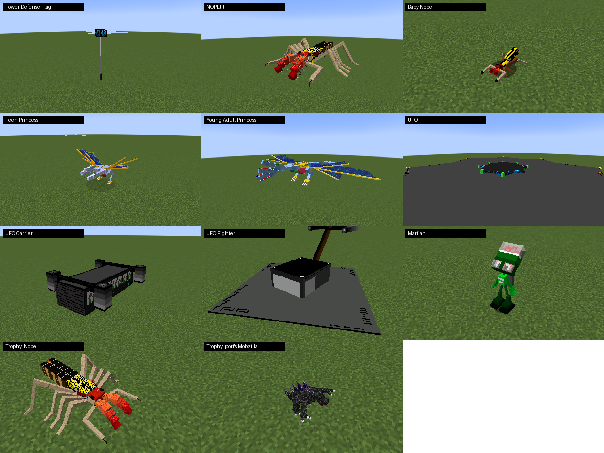

# OreSpawn: DangerZone

Creatures, items and things to do from **DangerZone**, the game TheyCallMeDanger built after OreSpawn,
brought to the [OreSpawn port](https://github.com/CoolFreeze23/Orespawn) for NeoForge 1.21.1.

**Version:** 0.2.0 · **Minecraft:** 1.21.1 · **Loader:** NeoForge 21.1+ · **Requires:** OreSpawn 2.0.0-beta.15 and GeckoLib

## What's in it

| | |
|---|---|
| **Nastysaurus Prime** | A boss with a boss bar that bites hard and calls a Needlenose pack into the fight. Mining and Chaos. |
| **Needlenose** | The Prime's pack hunter. It joins any fight a Prime nearby is having. Mining. |
| **Ant Queen** | A nearly nine-block-wide boss. Her strikes reach eight blocks, and every ant type climbs out beside her. Chaos and windswept hills. |
| **Bloodlust Ant** | The Queen's soldier. Chaos and windswept hills. |
| **Nurse Bug** | A daylight flyer that seeks out hurt players, Girlfriends and Boyfriends and heals them. Forests and several OreSpawn dimensions. |
| **Dimension Staff** | Walks the world's dimensions at the same coordinates. Use for the next one, sneak and use for the one before. You land on the nearest footing, or on a small platform if there is none. |
| **Dragon's Eye Sword** | Every hit blinks you to a safe spot near the target, facing it. |
| **A Freakin' Shrink Ray!!!** | Shrinks anything but a boss to a quarter of its size, with a sixteenth of its bite and a quarter of its armour. Players grow back after a minute; creatures don't. Shrunk creatures drop nothing. |
| **Duct Tape repair** | The port's Duct Tape plus any damaged unstackable item, in a crafting grid, repairs it fully and keeps its enchantments. |
| **Tower Defense Flag** | Plant it and hold it. Every 30 seconds a new species comes for it, weakest first, climbing a ladder of 54 creatures; it spins and smokes faster as it's hurt. Players can't damage it during the event. Survive and it pays out and comes back. Clears blocks around it unless `mobGriefing` or the config says otherwise. |
| **Trophies** | A rare drop of a tiny, spinning model of the creature that dropped it, for every creature in this mod and OreSpawn. Place one on a block; hit or use it to pick it up. |
| **NOPE!!! and Baby Nope** | A nine-block bug that spits acid, spawns babies and leaps. Chaos. |
| **Teen and Young Adult Princess** | The Princess's missing stages. Feed your baby Princess a diamond block to grow her, again to grow her more, and a diamond to take her back a stage. Tameable and rideable, and a Young Adult is nearly twelve blocks tall. |
| **Swarms** | Every so often a horde crosses the map, after a warning in chat, depending on your dimension and the time of day. |
| **Volcano** | An invisible point that builds its own mountain, throwing burning rock, lava, diamond ore and live explosives. Chaos and Mining. Follows `mobGriefing`. |
| **UFO, Carrier, Fighter, Martian** | A mothership hangs at height 200 and launches Fighters, which fire lasers, and Carriers, which land and let out ten Martians with ray guns and bows. Chaos and Village. |
| **Things To Do** | DangerZone's task list as an advancement tab, with its own titles, wherever the item or creature exists in the port. |

## Getting the items

- **Dimension Staff:** a Vortex Eye over two Ender Pearls and two Titanium Ingots, or a rare Ant Queen drop.
- **Dragon's Eye Sword:** two Dragon's Eyes on a stick. Nastysaurus Primes drop the eyes, and so do Dragons, Water Dragons, Spyros and Leonopteryxes.
- **Shrink Ray:** a Ray Gun surrounded by eight Amethyst Shards. Recharge it at an anvil with more shards.
- **Tower Defense Flag:** a banner on two Diamond Blocks.

## Faithful, with these differences

- Models, textures and sounds are DangerZone's own, and the models keep their original animation code.
- Health and damage are scaled to the port's numbers, keeping DangerZone's proportions between creatures.
- Summoning has caps, which DangerZone didn't: see `orespawn_dangerzone-common.toml`. Swarms are 60 strong rather than 100 to 199, and Nope no longer drops up to 39 of its own eggs.
- The flag pays in gems and ingots, since the port has no coins, and it brings its attackers in itself, since many OreSpawn creatures don't chase what they target.
- Nopes, UFOs and Volcanoes live in Chaos, Mining and Village, since the port has no Misfit dimension. Swarms use OreSpawn creatures where DangerZone's own aren't here.
- The Teen and Young Adult Princess fight and ride as the port's Teen and Adult Prince do, and grow by diamond block only.
- Martians fire ray guns and bows but don't show them in hand. Volcanoes make no thunderclouds.
- The Dimension Staff lands you safely, and has a recipe, since Kraken Kings don't exist here yet.
- Amethyst replaces Shrink Berries in the Shrink Ray recipe, and Dragons replace the Dragon's Lair as the source of Dragon's Eyes.
- Real-world political jokes from the original are left out.

## License & Ownership

**DangerZone and OreSpawn, their code, art and sounds, are the work of TheyCallMeDanger and the original
authors. All rights to the originals remain theirs.**

This is an unofficial preservation project. No ownership of the original work is claimed by anyone
involved, and it isn't sold or monetised. It contains DangerZone's textures and sounds, models converted
from its decompiled code, and task text from it. If you are an original author and want anything changed
or removed, open an issue and it will be, immediately.

`mods.toml` license field: **All Rights Reserved** (the originals' rights, not ours).

## Credits

- **TheyCallMeDanger** (Richard H. Clark) and the DangerZone and OreSpawn authors: the game, the mod, and
  everything taken from them.
- The Internet Archive, and the people who archived DangerZone there.
- The NeoForge port team: this add-on and the OreSpawn port.

## Reporting issues

[Issues](https://github.com/CoolFreeze23/orespawn-dangerzone/issues): include the mod version, exact steps,
what you expected and saw, and the log for crashes.

## Building

See `libs/README.md` for the jars to place first, then run `./gradlew build`.
`./gradlew runGameTestServer` runs the tests.
